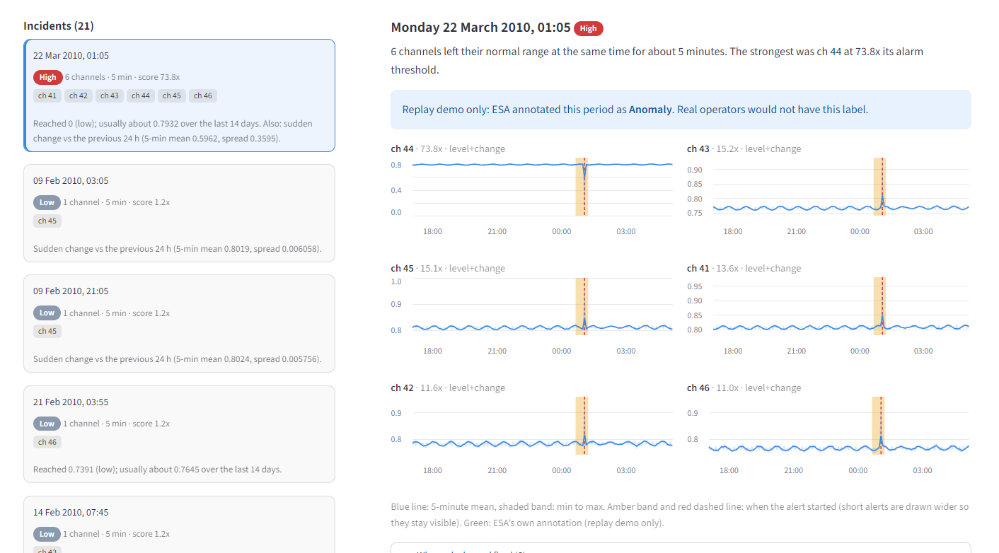

# Node13: telemetry anomaly triage for spacecraft operations

Node13 watches spacecraft telemetry next to the limit checks operators already use. It raises explained, low-noise alerts for human review when a channel changes in a way that is unusual for *that channel*, groups simultaneous alerts across channels into incidents, stores operator verdicts, and reports its own measured performance.

It is an operator-assist tool. It does not command anything, does not predict failures, and gives no failure probabilities.

**Status: research and portfolio prototype.** Tested on one public benchmark mission (below). It has not been validated on any other spacecraft.



## What it does

- **Scores telemetry per channel** with two label-free, past-only checks:
  - *Level*: each 5-minute bin against the channel's own level over the previous 14 days, updated daily.
  - *Change*: each bin against the previous 24 hours.
- **Keeps the alert rate bounded.** Alarm thresholds are re-set every week (in the app) or month (in the benchmark) from the previous 90 days, so each detector raises at most a chosen number of alerts per channel per week on normal data.
- **Groups alerts into incidents** when several channels alert at the same time, because simultaneous movement across channels is more meaningful than one channel alone.
- **Explains each alert** in plain language (what value was reached, what the usual level is) with a per-channel chart.
- **Stores operator verdicts** (real, expected, false alarm) in SQLite.
- **Runs live or as a replay.** `ingest` takes new telemetry as CSV; `replay` feeds historical data through as if it were arriving.

## Measured performance (reproduce it with the commands below)

Data: ESA-ADB Mission 1 (Zenodo 15237121), 76 channels, test period 2010 to 2013 (209 weeks), 34 distinct anomaly events. No labels are used by the detector. Thresholds were recalibrated monthly from the previous 90 days only.

An event counts as caught if an alert (or incident) overlaps it. Because some events last hours or days, every result is compared with random alarm placement with the same alarm durations ("chance").

**Per channel** (an event labelled on several channels counts on each):

| Budget (alerts / channel / week / detector) | Channel-level events caught | Chance | Distinct events caught (of 34) | Alerts / week, all 76 channels |
|---|---|---|---|---|
| 2 | 160 / 287 | 85.9 | 29 | 337 |
| 0.5 | 129 / 287 | 52.4 | 27 | 115 |
| 0.2 | 123 / 287 | 49.8 | 26 | 107 |
| 0.05 | 121 / 287 | 48.8 | 25 | 103 |

**As incidents** (budget 0.5; at least k channels alerting within 30 minutes):

| k | Incidents / week | Distinct events caught (of 34) | Chance | Time covered |
|---|---|---|---|---|
| 4 | 15.9 | 31 | 19.6 | 13.9% |
| 5 | 9.1 | 27 | 15.2 | 7.6% |
| **6** | **4.4** | **27** | **10.8** | **4.5%** |
| 8 | 1.6 | 17 | 5.7 | 2.0% |
| 10 | 0.5 | 7 | 2.5 | 0.6% |

At k=3 or lower the incident list is almost always active (27% to 75% of all time) and catches 34 of 34 with chance at 24 to 27, so those rows say nothing.

**Reading this honestly**

- At k=6 the system raises about 4 incidents a week across the whole mission and overlaps 27 of 34 events, against about 11 expected by chance: roughly 2.5 times chance.
- Most incidents do not overlap a labelled event. At k=6 over 209 weeks, 89 overlap a labelled anomaly, 50 overlap a labelled rare event or communication gap, and about 3.7 per week are unmatched. Unmatched does not necessarily mean false (the labels may be incomplete), but we cannot show otherwise.
- Alerts begin when the signal leaves its normal range. This is detection, not early warning: median delay against the labelled start is zero.
- A handful of channels stay in alarm much of the time (channels 61, 62, 63, 68 about 20%; 4 to 7, 10, 11 about 2.8%). Their normal level shifts, so the baseline does not settle. That sets a floor of roughly 100 channel alerts per week that tightening the budget does not remove.
- Sharp, short events on the mission's main channels (41 to 46) are caught best (12 to 13 of 16 to 18 events per channel at tight budgets). Channels 47 to 52 catch only 1 to 2 of 9 to 14.

## Limits

- One mission, one set of 34 events. Treat all numbers as indicative.
- No telecommand or planned-manoeuvre context, so planned changes look like anomalies. Mark them *expected*.
- Operator verdicts are stored but do not retrain anything yet.
- The exposure calculator in the dashboard is plain arithmetic on numbers you type. It does not estimate the chance of any contract being breached.
- It does not predict failures ahead of time.

## Run it

```
pip install -r node13_app/requirements.txt
python -m node13_app.cli replay --channels 41-46 --from 2010-01-01 --to 2010-07-01 --budget 0.2 --reset
streamlit run node13_app/dashboard.py
```

Reproduce the benchmark (about 30 minutes; needs the ESA-ADB Mission 1 download and 7-Zip):

```
python -m node13_v2.walkforward --channels all --cleanup
python -m node13_v2.incidents --alerts results_v3/alerts_b0.5.csv
```

Feed new data: `python -m node13_app.cli ingest --channel channel_44 --file new_data.csv` (CSV: `timestamp,value`).

## Layout

- `node13_app/` the service: engine, SQLite store, CLI, Streamlit dashboard
- `node13_v2/` the benchmark: binning, calibration, walk-forward evaluation, incident grouping
- `evaluate.py` an earlier benchmark, kept for the record. It showed the original LSTM-based scoring was not better than a simple calibrated level check, which is why the current design is simpler.

## Data

ESA-ADB: Kotowski et al., European Space Agency Anomaly Detection Benchmark, Zenodo record 15237121. Not included in this repository.
